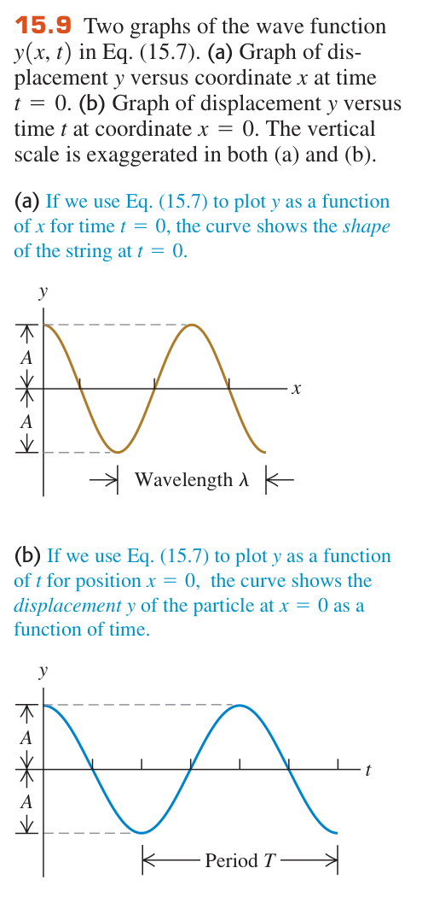
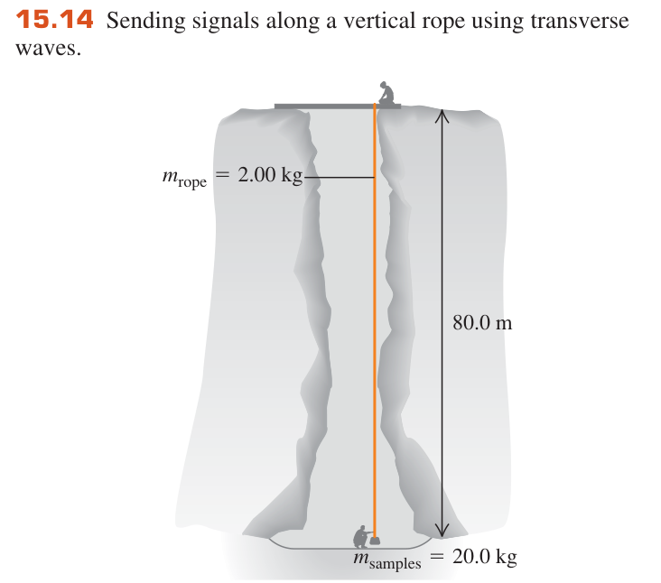
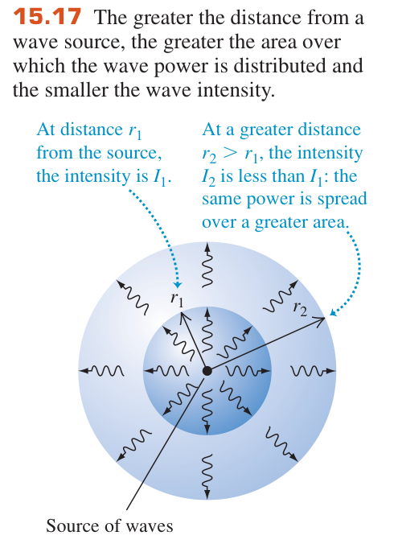
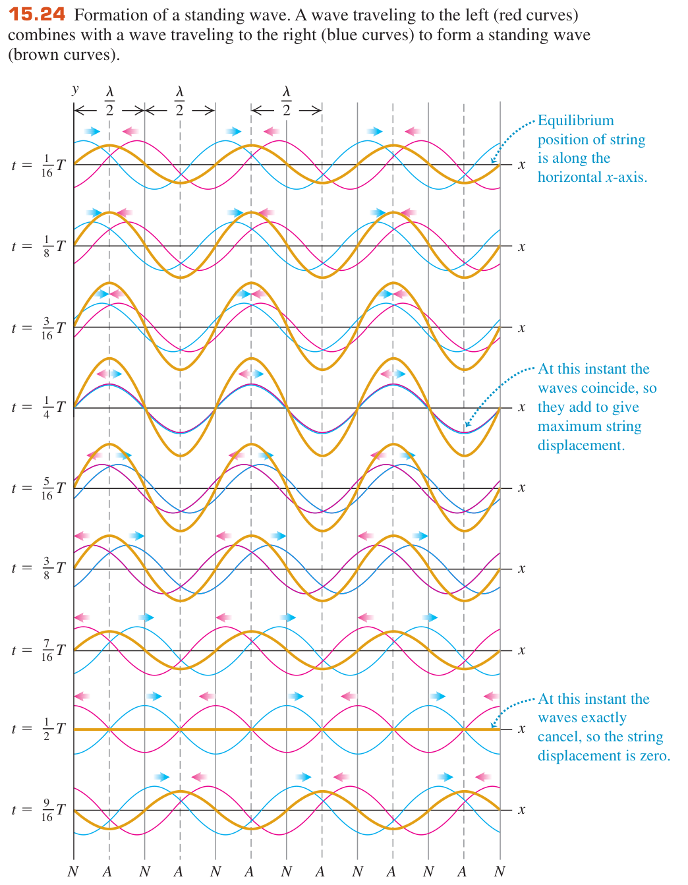
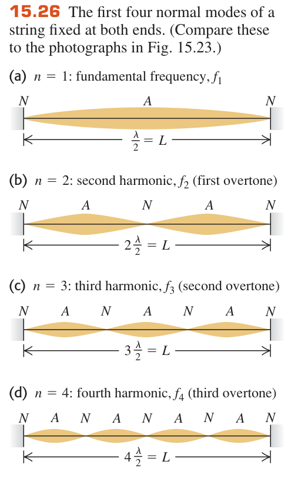

# Mechanical Waves — Worked Examples

Young and Freedman, *University Physics with Modern Physics*, 13th edition, Chapter 15. The eight numbered examples below retain the textbook's questions and Identify and Set Up / Execute / Evaluate working. Equations use Obsidian's inline and display math delimiters; line wrapping and typography have been normalized. Scanned figures are included where the examples refer to them or where they support the setup.

See [[18 - Physics/Physics Young and Freedman/Mechanics/15 - Mechanical Waves/Notes]] for the distilled chapter explanations and derivations marked **needs expansion**.

# Example 15.1 — Wavelength of a musical sound

Sound waves are longitudinal waves in air. The speed of sound depends on temperature; at $20^\circ\mathrm{C}$ it is $344\ \mathrm{m/s}$ ($1130\ \mathrm{ft/s}$). What is the wavelength of a sound wave in air at $20^\circ\mathrm{C}$ if the frequency is $262\ \mathrm{Hz}$ (the approximate frequency of middle C on a piano)?

## Solution

### Identify and Set Up

This problem involves Eq. (15.1), $v=\lambda f$, which relates wave speed $v$, wavelength $\lambda$, and frequency $f$ for a periodic wave. The target variable is the wavelength $\lambda$. We are given $v=344\ \mathrm{m/s}$ and $f=262\ \mathrm{Hz}=262\ \mathrm{s^{-1}}$.

### Execute

We solve Eq. (15.1) for $\lambda$:

$$
\lambda=\frac{v}{f}=\frac{344\ \mathrm{m/s}}{262\ \mathrm{Hz}}
=\frac{344\ \mathrm{m/s}}{262\ \mathrm{s^{-1}}}=1.31\ \mathrm{m}
$$

### Evaluate

The speed $v$ of sound waves does not depend on the frequency. Hence $\lambda=v/f$ says that wavelength changes in inverse proportion to frequency. As an example, high (soprano) C is two octaves above middle C. Each octave corresponds to a factor of 2 in frequency, so the frequency of high C is four times that of middle C: $f=4(262\ \mathrm{Hz})=1048\ \mathrm{Hz}$. Hence the wavelength of high C is one-fourth as large: $\lambda=(1.31\ \mathrm{m})/4=0.328\ \mathrm{m}$.

# Example 15.2 — Wave on a clothesline

Cousin Throckmorton holds one end of the clothesline taut and wiggles it up and down sinusoidally with frequency $2.00\ \mathrm{Hz}$ and amplitude $0.075\ \mathrm{m}$. The wave speed on the clothesline is $v=12.0\ \mathrm{m/s}$. At $t=0$ Throcky's end has maximum positive displacement and is instantaneously at rest. Assume that no wave bounces back from the far end. (a) Find the wave amplitude $A$, angular frequency $\omega$, period $T$, wavelength $\lambda$, and wave number $k$. (b) Write a wave function describing the wave. (c) Write equations for the displacement, as a function of time, of Throcky's end of the clothesline and of a point $3.00\ \mathrm{m}$ from that end.

## Solution

### Identify and Set Up

This is a kinematics problem about the clothesline's wave motion. Throcky produces a sinusoidal wave that propagates along the clothesline, so we can use all of the expressions of this section. In part (a) our target variables are $A$, $\omega$, $T$, $\lambda$, and $k$. We use the relationships $\omega=2\pi f$, $f=1/T$, $v=\lambda f$, and $k=2\pi/\lambda$. In parts (b) and (c) our target “variables” are expressions for displacement, which we'll obtain from an appropriate equation for the wave function. We take the positive $x$-direction to be the direction in which the wave propagates, so either Eq. (15.4) or (15.7) will yield the desired expression. A photograph of the clothesline at time $t=0$ would look like Fig. 15.9a, with the maximum displacement at $x=0$ (the end that Throcky holds).

### Execute

(a) The wave amplitude and frequency are the same as for the oscillations of Throcky's end of the clothesline, $A=0.075\ \mathrm{m}$ and $f=2.00\ \mathrm{Hz}$. Hence

$$
\begin{aligned}
\omega&=2\pi f
=\left(2\pi\frac{\mathrm{rad}}{\mathrm{cycle}}\right)
\left(2.00\frac{\mathrm{cycles}}{\mathrm{s}}\right)\\
&=4.00\pi\ \mathrm{rad/s}=12.6\ \mathrm{rad/s}
\end{aligned}
$$

The period is $T=1/f=0.500\ \mathrm{s}$, and from Eq. (15.1),

$$
\lambda=\frac{v}{f}=\frac{12.0\ \mathrm{m/s}}{2.00\ \mathrm{s^{-1}}}=6.00\ \mathrm{m}
$$

We find the wave number from Eq. (15.5) or (15.6):

$$
k=\frac{2\pi}{\lambda}=\frac{2\pi\ \mathrm{rad}}{6.00\ \mathrm{m}}=1.05\ \mathrm{rad/m}
$$

or

$$
k=\frac{\omega}{v}=\frac{4.00\pi\ \mathrm{rad/s}}{12.0\ \mathrm{m/s}}=1.05\ \mathrm{rad/m}
$$

(b) We write the wave function using Eq. (15.4) and the values of $A$, $T$, and $\lambda$ from part (a):

$$
\begin{aligned}
y(x,t)&=A\cos 2\pi\left(\frac{x}{\lambda}-\frac{t}{T}\right)\\
&=(0.075\ \mathrm{m})\cos 2\pi\left(\frac{x}{6.00\ \mathrm{m}}-\frac{t}{0.500\ \mathrm{s}}\right)\\
&=(0.075\ \mathrm{m})\cos\bigl[(1.05\ \mathrm{rad/m})x-(12.6\ \mathrm{rad/s})t\bigr]
\end{aligned}
$$

We can also get this same expression from Eq. (15.7) by using the values of $\omega$ and $k$ from part (a).

(c) We can find the displacement as a function of time at $x=0$ and $x=+3.00\ \mathrm{m}$ by substituting these values into the wave function from part (b):

$$
\begin{aligned}
y(x=0,t)&=(0.075\ \mathrm{m})\cos 2\pi\left(\frac{0}{6.00\ \mathrm{m}}-\frac{t}{0.500\ \mathrm{s}}\right)\\
&=(0.075\ \mathrm{m})\cos(12.6\ \mathrm{rad/s})t
\end{aligned}
$$

$$
\begin{aligned}
y(x=+3.00\ \mathrm{m},t)&=(0.075\ \mathrm{m})\cos 2\pi\left(\frac{3.00\ \mathrm{m}}{6.00\ \mathrm{m}}-\frac{t}{0.500\ \mathrm{s}}\right)\\
&=(0.075\ \mathrm{m})\cos\bigl[\pi-(12.6\ \mathrm{rad/s})t\bigr]\\
&=-(0.075\ \mathrm{m})\cos(12.6\ \mathrm{rad/s})t
\end{aligned}
$$

### Evaluate

In part (b), the quantity $(1.05\ \mathrm{rad/m})x-(12.6\ \mathrm{rad/s})t$ is the phase of a point $x$ on the string at time $t$. The two points in part (c) oscillate in SHM with the same frequency and amplitude, but their oscillations differ in phase by $(1.05\ \mathrm{rad/m})(3.00\ \mathrm{m})=3.15\ \mathrm{rad}\simeq\pi$ radians—that is, one-half cycle—because the points are separated by one half-wavelength: $\lambda/2=(6.00\ \mathrm{m})/2=3.00\ \mathrm{m}$. Thus, while a graph of $y$ versus $t$ for the point at $x=0$ is a cosine curve (like Fig. 15.9b), a graph of $y$ versus $t$ for the point $x=3.00\ \mathrm{m}$ is a negative cosine curve (the same as a cosine curve shifted by one half-cycle).

Using the expression for $y(x=0,t)$ in part (c), can you show that the end of the string at $x=0$ is instantaneously at rest at $t=0$, as stated at the beginning of this example? (*Hint:* Calculate the $y$-velocity at this point by taking the derivative of $y$ with respect to $t$.)

# Example 15.3 — Calculating wave speed

One end of a $2.00$-kg rope is tied to a support at the top of a mine shaft $80.0\ \mathrm{m}$ deep (Fig. 15.14). The rope is stretched taut by a $20.0$-kg box of rocks attached at the bottom. (a) The geologist at the bottom of the shaft signals to a colleague at the top by jerking the rope sideways. What is the speed of a transverse wave on the rope? (b) If a point on the rope is in transverse SHM with $f=2.00\ \mathrm{Hz}$, how many cycles of the wave are there in the rope's length?

## Solution

### Identify and Set Up

In part (a) we can find the wave speed (our target variable) using the dynamic relationship $v=\sqrt{F/\mu}$ [Eq. (15.13)]. In part (b) we find the wavelength from the kinematic relationship $v=f\lambda$; from that we can find the target variable, the number of wavelengths that fit into the rope's $80.0$-m length. We'll assume that the rope is massless (even though its weight is 10% that of the box), so that the box alone provides the tension in the rope.

### Execute

(a) The tension in the rope due to the box is

$$
F=m_{\mathrm{box}}g=(20.0\ \mathrm{kg})(9.80\ \mathrm{m/s^2})=196\ \mathrm{N}
$$

and the rope's linear mass density is

$$
\mu=\frac{m_{\mathrm{rope}}}{L}=\frac{2.00\ \mathrm{kg}}{80.0\ \mathrm{m}}=0.0250\ \mathrm{kg/m}
$$

Hence, from Eq. (15.13), the wave speed is

$$
v=\sqrt{\frac{F}{\mu}}=\sqrt{\frac{196\ \mathrm{N}}{0.0250\ \mathrm{kg/m}}}=88.5\ \mathrm{m/s}
$$

(b) From Eq. (15.1), the wavelength is

$$
\lambda=\frac{v}{f}=\frac{88.5\ \mathrm{m/s}}{2.00\ \mathrm{s^{-1}}}=44.3\ \mathrm{m}
$$

There are $(80.0\ \mathrm{m})/(44.3\ \mathrm{m})=1.81$ wavelengths (that is, cycles of the wave) in the rope.

### Evaluate

Because of the rope's weight, its tension is greater at the top than at the bottom. Hence both the wave speed and the wavelength increase as a wave travels up the rope. If you take account of this, can you verify that the wave speed at the top of the rope is $92.9\ \mathrm{m/s}$?

> [!note] Clarification of the textbook approximation
> “Massless” above means that the rope's weight is neglected when calculating the tension. Its nonzero mass per unit length is still retained for the wave's inertia.

# Example 15.4 — Power in a wave

(a) In Example 15.2 (Section 15.3), at what maximum rate does Throcky put energy into the clothesline? That is, what is his maximum instantaneous power? The linear mass density of the clothesline is $\mu=0.250\ \mathrm{kg/m}$, and Throcky applies tension $F=36.0\ \mathrm{N}$. (b) What is his average power? (c) As Throcky tires, the amplitude decreases. What is the average power when the amplitude is $7.50\ \mathrm{mm}$?

## Solution

### Identify and Set Up

In part (a) our target variable is the maximum instantaneous power $P_{\max}$, while in parts (b) and (c) it is the average power. For part (a) we'll use Eq. (15.24), and for parts (b) and (c) we'll use Eq. (15.25); Example 15.2 gives us all the needed quantities.

### Execute

(a) From Eq. (15.24),

$$
\begin{aligned}
P_{\max}&=\sqrt{\mu F}\,\omega^2A^2\\
&=\sqrt{(0.250\ \mathrm{kg/m})(36.0\ \mathrm{N})}(4.00\pi\ \mathrm{rad/s})^2(0.075\ \mathrm{m})^2\\
&=2.66\ \mathrm{W}
\end{aligned}
$$

(b) From Eqs. (15.24) and (15.25), the average power is one-half of the maximum instantaneous power, so

$$
P_{\mathrm{av}}=\frac12P_{\max}=\frac12(2.66\ \mathrm{W})=1.33\ \mathrm{W}
$$

(c) The new amplitude is $1/10$ of the value we used in parts (a) and (b). From Eq. (15.25), the average power is proportional to $A^2$, so the new average power is

$$
P_{\mathrm{av}}=\left(\frac{1}{10}\right)^2(1.33\ \mathrm{W})=0.0133\ \mathrm{W}=13.3\ \mathrm{mW}
$$

### Evaluate

Equation (15.23) shows that $P_{\max}$ occurs when $\sin^2(kx-\omega t)=1$. At any given position $x$, this happens twice per period of the wave—once when the sine function is equal to $+1$, and once when it's equal to $-1$. The minimum instantaneous power is zero; this occurs when $\sin^2(kx-\omega t)=0$, which also happens twice per period.

Can you confirm that the given values of $\mu$ and $F$ give the wave speed mentioned in Example 15.2?

# Example 15.5 — The inverse-square law

A siren on a tall pole radiates sound waves uniformly in all directions. At a distance of $15.0\ \mathrm{m}$ from the siren, the sound intensity is $0.250\ \mathrm{W/m^2}$. At what distance is the intensity $0.010\ \mathrm{W/m^2}$?

## Solution

### Identify and Set Up

Because sound is radiated uniformly in all directions, we can use the inverse-square law, Eq. (15.26). At $r_1=15.0\ \mathrm{m}$ the intensity is $I_1=0.250\ \mathrm{W/m^2}$, and the target variable is the distance $r_2$ at which the intensity is $I_2=0.010\ \mathrm{W/m^2}$.

### Execute

We solve Eq. (15.26) for $r_2$:

$$
r_2=r_1\sqrt{\frac{I_1}{I_2}}
=(15.0\ \mathrm{m})\sqrt{\frac{0.250\ \mathrm{W/m^2}}{0.010\ \mathrm{W/m^2}}}=75.0\ \mathrm{m}
$$

### Evaluate

As a check on our answer, note that $r_2$ is five times greater than $r_1$. By the inverse-square law, the intensity $I_2$ should be $1/5^2=1/25$ as great as $I_1$, and indeed it is.

By using the inverse-square law, we've assumed that the sound waves travel in straight lines away from the siren. A more realistic solution, which is beyond our scope, would account for the reflection of sound waves from the ground.

# Example 15.6 — Standing waves on a guitar string

A guitar string lies along the $x$-axis when in equilibrium. The end of the string at $x=0$ (the bridge of the guitar) is fixed. A sinusoidal wave with amplitude $A=0.750\ \mathrm{mm}=7.50\times10^{-4}\ \mathrm{m}$ and frequency $f=440\ \mathrm{Hz}$, corresponding to the red curves in Fig. 15.24, travels along the string in the $-x$-direction at $143\ \mathrm{m/s}$. It is reflected from the fixed end, and the superposition of the incident and reflected waves forms a standing wave. (a) Find the equation giving the displacement of a point on the string as a function of position and time. (b) Locate the nodes. (c) Find the amplitude of the standing wave and the maximum transverse velocity and acceleration.

## Solution

### Identify and Set Up

This is a kinematics problem (see Problem-Solving Strategy 15.1 in Section 15.3). The target variables are: in part (a), the wave function of the standing wave; in part (b), the locations of the nodes; and in part (c), the maximum displacement $y$, transverse velocity $v_y$, and transverse acceleration $a_y$. Since there is a fixed end at $x=0$, we can use Eqs. (15.28) and (15.29) to describe this standing wave. We will need the relationships $\omega=2\pi f$, $v=\omega/k$, and $v=\lambda f$.

### Execute

(a) The standing-wave amplitude is $A_{\mathrm{SW}}=2A=1.50\times10^{-3}\ \mathrm{m}$ (twice the amplitude of either the incident or reflected wave). The angular frequency and wave number are

$$
\omega=2\pi f=(2\pi\ \mathrm{rad})(440\ \mathrm{s^{-1}})=2760\ \mathrm{rad/s}
$$

$$
k=\frac{\omega}{v}=\frac{2760\ \mathrm{rad/s}}{143\ \mathrm{m/s}}=19.3\ \mathrm{rad/m}
$$

Equation (15.28) then gives

$$
\begin{aligned}
y(x,t)&=(A_{\mathrm{SW}}\sin kx)\sin\omega t\\
&=\bigl[(1.50\times10^{-3}\ \mathrm{m})\sin(19.3\ \mathrm{rad/m})x\bigr]\sin(2760\ \mathrm{rad/s})t
\end{aligned}
$$

(b) From Eq. (15.29), the positions of the nodes are $x=0$, $\lambda/2$, $\lambda$, $3\lambda/2$, $\ldots$. The wavelength is $\lambda=v/f=(143\ \mathrm{m/s})/(440\ \mathrm{Hz})=0.325\ \mathrm{m}$, so the nodes are at $x=0$, $0.163\ \mathrm{m}$, $0.325\ \mathrm{m}$, $0.488\ \mathrm{m}$, $\ldots$.

(c) From the expression for $y(x,t)$ in part (a), the maximum displacement from equilibrium is $A_{\mathrm{SW}}=1.50\times10^{-3}\ \mathrm{m}=1.50\ \mathrm{mm}$. This occurs at the antinodes, which are midway between adjacent nodes (that is, at $x=0.081\ \mathrm{m}$, $0.244\ \mathrm{m}$, $0.406\ \mathrm{m}$, $\ldots$).

For a particle on the string at any point $x$, the transverse ($y$-) velocity is

$$
\begin{aligned}
v_y(x,t)&=\frac{\partial y(x,t)}{\partial t}\\
&=\bigl[(1.50\times10^{-3}\ \mathrm{m})\sin(19.3\ \mathrm{rad/m})x\bigr]\\
&\qquad\times\bigl[(2760\ \mathrm{rad/s})\cos(2760\ \mathrm{rad/s})t\bigr]\\
&=\bigl[(4.15\ \mathrm{m/s})\sin(19.3\ \mathrm{rad/m})x\bigr]\cos(2760\ \mathrm{rad/s})t
\end{aligned}
$$

At an antinode, $\sin(19.3\ \mathrm{rad/m})x=\pm1$ and the transverse velocity varies between $+4.15\ \mathrm{m/s}$ and $-4.15\ \mathrm{m/s}$. As is always the case in SHM, the maximum velocity occurs when the particle is passing through the equilibrium position ($y=0$).

The transverse acceleration $a_y(x,t)$ is the second partial derivative of $y(x,t)$ with respect to time. You can show that

$$
\begin{aligned}
a_y(x,t)&=\frac{\partial v_y(x,t)}{\partial t}=\frac{\partial^2 y(x,t)}{\partial t^2}\\
&=\bigl[(-1.15\times10^4\ \mathrm{m/s^2})\sin(19.3\ \mathrm{rad/m})x\bigr]\sin(2760\ \mathrm{rad/s})t
\end{aligned}
$$

At the antinodes, the transverse acceleration varies between $+1.15\times10^4\ \mathrm{m/s^2}$ and $-1.15\times10^4\ \mathrm{m/s^2}$.

### Evaluate

The maximum transverse velocity at an antinode is quite respectable (about $15\ \mathrm{km/h}$, or $9.3\ \mathrm{mi/h}$). But the maximum transverse acceleration is tremendous, 1170 times the acceleration due to gravity! Guitar strings are actually fixed at both ends; we'll see the consequences of this in the next section.

# Example 15.7 — A giant bass viol

In an attempt to get your name in *Guinness World Records*, you build a bass viol with strings of length $5.00\ \mathrm{m}$ between fixed points. One string, with linear mass density $40.0\ \mathrm{g/m}$, is tuned to a $20.0$-Hz fundamental frequency (the lowest frequency that the human ear can hear). Calculate (a) the tension of this string, (b) the frequency and wavelength on the string of the second harmonic, and (c) the frequency and wavelength on the string of the second overtone.

## Solution

### Identify and Set Up

In part (a) the target variable is the string tension $F$; we'll use Eq. (15.35), which relates $F$ to the known values $f_1=20.0\ \mathrm{Hz}$, $L=5.00\ \mathrm{m}$, and $\mu=40.0\ \mathrm{g/m}$. In parts (b) and (c) the target variables are the frequency and wavelength of a given harmonic and a given overtone. We determine these from the given length of the string and the fundamental frequency, using Eqs. (15.31) and (15.33).

### Execute

(a) We solve Eq. (15.35) for $F$:

$$
\begin{aligned}
F&=4\mu L^2f_1^2\\
&=4(40.0\times10^{-3}\ \mathrm{kg/m})(5.00\ \mathrm{m})^2(20.0\ \mathrm{s^{-1}})^2\\
&=1600\ \mathrm{N}=360\ \mathrm{lb}
\end{aligned}
$$

(b) From Eqs. (15.33) and (15.31), the frequency and wavelength of the second harmonic ($n=2$) are

$$
f_2=2f_1=2(20.0\ \mathrm{Hz})=40.0\ \mathrm{Hz}
$$

$$
\lambda_2=\frac{2L}{2}=\frac{2(5.00\ \mathrm{m})}{2}=5.00\ \mathrm{m}
$$

(c) The second overtone is the “second tone over” (above) the fundamental—that is, $n=3$. Its frequency and wavelength are

$$
f_3=3f_1=3(20.0\ \mathrm{Hz})=60.0\ \mathrm{Hz}
$$

$$
\lambda_3=\frac{2L}{3}=\frac{2(5.00\ \mathrm{m})}{3}=3.33\ \mathrm{m}
$$

### Evaluate

The string tension in a real bass viol is typically a few hundred newtons; the tension in part (a) is a bit higher than that. The wavelengths in parts (b) and (c) are equal to the length of the string and two-thirds the length of the string, respectively, which agrees with the drawings of standing waves in Fig. 15.26.

# Example 15.8 — From waves on a string to sound waves in air

What are the frequency and wavelength of the sound waves produced in the air when the string in Example 15.7 is vibrating at its fundamental frequency? The speed of sound in air at $20^\circ\mathrm{C}$ is $344\ \mathrm{m/s}$.

## Solution

### Identify and Set Up

Our target variables are the frequency and wavelength for the sound wave produced by the bass viol string. The frequency of the sound wave is the same as the fundamental frequency $f_1$ of the standing wave, because the string forces the surrounding air to vibrate at the same frequency. The wavelength of the sound wave is $\lambda_{1(\mathrm{sound})}=v_{\mathrm{sound}}/f_1$.

### Execute

We have $f=f_1=20.0\ \mathrm{Hz}$, so

$$
\lambda_{1(\mathrm{sound})}=\frac{v_{\mathrm{sound}}}{f_1}
=\frac{344\ \mathrm{m/s}}{20.0\ \mathrm{Hz}}=17.2\ \mathrm{m}
$$

### Evaluate

In Example 15.7, the wavelength of the fundamental on the string was $\lambda_{1(\mathrm{string})}=2L=2(5.00\ \mathrm{m})=10.0\ \mathrm{m}$. Here $\lambda_{1(\mathrm{sound})}=17.2\ \mathrm{m}$ is greater than that by the factor of $17.2/10.0=1.72$. This is as it should be: Because the frequencies of the sound wave and the standing wave are equal, $\lambda=v/f$ says that the wavelengths in air and on the string are in the same ratio as the corresponding wave speeds; here $v_{\mathrm{sound}}=344\ \mathrm{m/s}$ is greater than $v_{\mathrm{string}}=(10.0\ \mathrm{m})(20.0\ \mathrm{Hz})=200\ \mathrm{m/s}$ by just the factor $1.72$.
