# Sound and Acoustics — Worked Examples

Young and Freedman, *University Physics with Modern Physics*, 13th edition, Chapter 16, “Sound and Hearing.” The questions and working of Examples 16.1–16.19 are transcribed below with Obsidian math formatting and normalized typography. The textbook's solution-stage groupings are retained, including the ungrouped solution in Conceptual Example 16.10. Explicit transcription corrections are noted where needed.

See [[Notes]] for the chapter explanations and named **needs expansion** derivations.

# Example 16.1 — Amplitude of a sound wave in air

In a sinusoidal sound wave of moderate loudness, the maximum pressure variations are about $3.0\times10^{-2}\ \mathrm{Pa}$ above and below atmospheric pressure. Find the corresponding maximum displacement if the frequency is $1000\ \mathrm{Hz}$. In air at normal atmospheric pressure and density, the speed of sound is $344\ \mathrm{m/s}$ and the bulk modulus is $1.42\times10^5\ \mathrm{Pa}$.

## Solution

### Identify and Set Up

This problem involves the relationship between two ways of describing a sound wave: in terms of displacement and in terms of pressure. The target variable is the displacement amplitude $A$. We are given the pressure amplitude $p_{\max}$, wave speed $v$, frequency $f$, and bulk modulus $B$. Equation (16.5) relates the target variable $A$ to $p_{\max}$. We use $\omega=vk$ [Eq. (15.6)] to determine the wave number $k$ from $v$ and the angular frequency $\omega=2\pi f$.

### Execute

From Eq. (15.6),

$$
k=\frac{\omega}{v}=\frac{2\pi f}{v}
=\frac{(2\pi\ \mathrm{rad})(1000\ \mathrm{Hz})}{344\ \mathrm{m/s}}
=18.3\ \mathrm{rad/m}
$$

Then from Eq. (16.5), the maximum displacement is

$$
A=\frac{p_{\max}}{Bk}
=\frac{3.0\times10^{-2}\ \mathrm{Pa}}{(1.42\times10^5\ \mathrm{Pa})(18.3\ \mathrm{rad/m})}
=1.2\times10^{-8}\ \mathrm{m}
$$

### Evaluate

This displacement amplitude is only about $1/100$ the size of a human cell. The ear actually senses pressure fluctuations; it detects these minuscule displacements only indirectly.

# Example 16.2 — Amplitude of a sound wave in the inner ear

A sound wave that enters the human ear sets the eardrum into oscillation, which in turn causes oscillation of the ossicles, a chain of three tiny bones in the middle ear (Fig. 16.4). The ossicles transmit this oscillation to the fluid (mostly water) in the inner ear; there the fluid motion disturbs hair cells that send nerve impulses to the brain with information about the sound. The area of the moving part of the eardrum is about $43\ \mathrm{mm^2}$, and that of the stapes (the smallest of the ossicles) where it connects to the inner ear is about $3.2\ \mathrm{mm^2}$. For the sound in Example 16.1, determine (a) the pressure amplitude and (b) the displacement amplitude of the wave in the fluid of the inner ear, in which the speed of sound is $1500\ \mathrm{m/s}$.

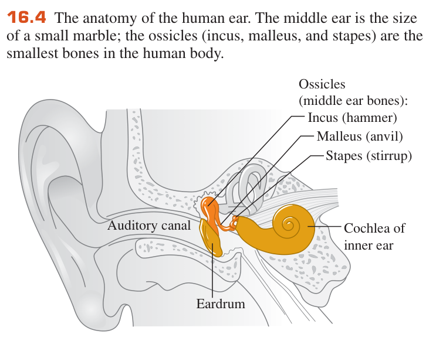

> [!note] Printed figure labels
> The scan preserves the book's labels, which interchange the common names of the incus and malleus. The incus is the anvil, and the malleus is the hammer.

## Solution

### Identify and Set Up

Although the sound wave here travels in liquid rather than air, the same principles and relationships among the properties of the wave apply. We can neglect the mass of the tiny ossicles (about $58\ \mathrm{mg}=5.8\times10^{-5}\ \mathrm{kg}$), so the force they exert on the inner-ear fluid is the same as that exerted on the eardrum and ossicles by the incident sound wave. (In Chapters 4 and 5 we used the same idea to say that the tension is the same at either end of a massless rope.) Hence the pressure amplitude in the inner ear, $p_{\max(\mathrm{inner\ ear})}$, is greater than in the outside air, $p_{\max(\mathrm{air})}$, because the same force is exerted on a smaller area (the area of the stapes versus the area of the eardrum). Given $p_{\max(\mathrm{inner\ ear})}$, we find the displacement amplitude $A_{\mathrm{inner\ ear}}$ using Eq. (16.5).

### Execute

(a) From the area of the eardrum and the pressure amplitude in air found in Example 16.1, the maximum force exerted by the sound wave in air on the eardrum is $F_{\max}=p_{\max(\mathrm{air})}S_{\mathrm{eardrum}}$. Then

$$
\begin{aligned}
p_{\max(\mathrm{inner\ ear})}
&=\frac{F_{\max}}{S_{\mathrm{stapes}}}
=p_{\max(\mathrm{air})}\frac{S_{\mathrm{eardrum}}}{S_{\mathrm{stapes}}}\\
&=(3.0\times10^{-2}\ \mathrm{Pa})\frac{43\ \mathrm{mm^2}}{3.2\ \mathrm{mm^2}}=0.40\ \mathrm{Pa}
\end{aligned}
$$

(b) To find the maximum displacement $A_{\mathrm{inner\ ear}}$, we use $A=p_{\max}/Bk$ as in Example 16.1. The inner-ear fluid is mostly water, which has a much greater bulk modulus $B$ than air. From Table 11.2 the compressibility of water (unfortunately also called $k$) is $45.8\times10^{-11}\ \mathrm{Pa^{-1}}$, so $B_{\mathrm{fluid}}=1/(45.8\times10^{-11}\ \mathrm{Pa^{-1}})=2.18\times10^9\ \mathrm{Pa}$.

The wave in the inner ear has the same angular frequency $\omega$ as the wave in the air because the air, eardrum, ossicles, and inner-ear fluid all oscillate together (see Example 15.8 in Section 15.8). But because the wave speed $v$ is greater in the inner ear than in the air ($1500\ \mathrm{m/s}$ versus $344\ \mathrm{m/s}$), the wave number $k=\omega/v$ is smaller. Using the value of $\omega$ from Example 16.1,

$$
k_{\mathrm{inner\ ear}}=\frac{\omega}{v_{\mathrm{inner\ ear}}}
=\frac{(2\pi\ \mathrm{rad})(1000\ \mathrm{Hz})}{1500\ \mathrm{m/s}}=4.2\ \mathrm{rad/m}
$$

Putting everything together, we have

$$
\begin{aligned}
A_{\mathrm{inner\ ear}}
&=\frac{p_{\max(\mathrm{inner\ ear})}}{B_{\mathrm{fluid}}k_{\mathrm{inner\ ear}}}\\
&=\frac{0.40\ \mathrm{Pa}}{(2.18\times10^9\ \mathrm{Pa})(4.2\ \mathrm{rad/m})}
=4.4\times10^{-11}\ \mathrm{m}
\end{aligned}
$$

### Evaluate

In part (a) we see that the ossicles increase the pressure amplitude by a factor of $(43\ \mathrm{mm^2})/(3.2\ \mathrm{mm^2})=13$. This amplification helps give the human ear its great sensitivity.

The displacement amplitude in the inner ear is even smaller than in the air. But pressure variations within the inner-ear fluid are what set the hair cells into motion, so what matters is that the pressure amplitude is larger in the inner ear than in the air.

# Example 16.3 — Wavelength of sonar waves

A ship uses a sonar system (Fig. 16.8) to locate underwater objects. Find the speed of sound waves in water using Eq. (16.7), and find the wavelength of a $262$-Hz wave.

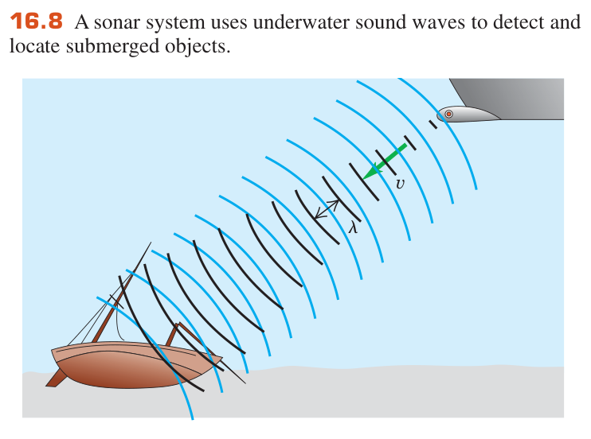

## Solution

### Identify and Set Up

Our target variables are the speed and wavelength of a sound wave in water. In Eq. (16.7), we use the density of water, $\rho=1.00\times10^3\ \mathrm{kg/m^3}$, and the bulk modulus of water, which we find from the compressibility (see Table 11.2). Given the speed and the frequency $f=262\ \mathrm{Hz}$, we find the wavelength from $v=f\lambda$.

### Execute

In Example 16.2, we used Table 11.2 to find $B=2.18\times10^9\ \mathrm{Pa}$. Then

$$
v=\sqrt{\frac{B}{\rho}}=\sqrt{\frac{2.18\times10^9\ \mathrm{Pa}}{1.00\times10^3\ \mathrm{kg/m^3}}}
=1480\ \mathrm{m/s}
$$

and

$$
\lambda=\frac{v}{f}=\frac{1480\ \mathrm{m/s}}{262\ \mathrm{s^{-1}}}=5.65\ \mathrm{m}
$$

### Evaluate

The calculated value of $v$ agrees well with the value in Table 16.1. Water is denser than air ($\rho$ is larger) but is also much more incompressible ($B$ is much larger), and so the speed $v=\sqrt{B/\rho}$ is greater than the $344$-m/s speed of sound in air at ordinary temperatures. The relationship $\lambda=v/f$ then says that a sound wave in water must have a longer wavelength than a wave of the same frequency in air. Indeed, we found in Example 15.1 (Section 15.2) that a $262$-Hz sound wave in air has a wavelength of only $1.31\ \mathrm{m}$.

# Example 16.4 — Speed of sound in air

Find the speed of sound in air at $T=20^\circ\mathrm{C}$, and find the range of wavelengths in air to which the human ear (which can hear frequencies in the range of $20$–$20{,}000\ \mathrm{Hz}$) is sensitive. The mean molar mass for air (a mixture of mostly nitrogen and oxygen) is $M=28.8\times10^{-3}\ \mathrm{kg/mol}$, and the ratio of heat capacities is $\gamma=1.40$.

## Solution

### Identify and Set Up

We use Eq. (16.10) to find the sound speed from $\gamma$, $T$, and $M$, and we use $v=f\lambda$ to find the wavelengths corresponding to the frequency limits. Note that in Eq. (16.10) temperature $T$ must be expressed in kelvins, not Celsius degrees.

### Execute

At $T=20^\circ\mathrm{C}=293\ \mathrm{K}$, we find

$$
v=\sqrt{\frac{\gamma RT}{M}}
=\sqrt{\frac{(1.40)(8.314\ \mathrm{J/(mol\cdot K)})(293\ \mathrm{K})}{28.8\times10^{-3}\ \mathrm{kg/mol}}}
=344\ \mathrm{m/s}
$$

Using this value of $v$ in $\lambda=v/f$, we find that at $20^\circ\mathrm{C}$ the frequency $f=20\ \mathrm{Hz}$ corresponds to $\lambda=17\ \mathrm{m}$ and $f=20{,}000\ \mathrm{Hz}$ to $\lambda=1.7\ \mathrm{cm}$.

### Evaluate

Our calculated value of $v$ agrees with the measured sound speed at $T=20^\circ\mathrm{C}$ to within $0.3\%$.

# Example 16.5 — Intensity of a sound wave in air

Find the intensity of the sound wave in Example 16.1, with $p_{\max}=3.0\times10^{-2}\ \mathrm{Pa}$. Assume the temperature is $20^\circ\mathrm{C}$ so that the density of air is $\rho=1.20\ \mathrm{kg/m^3}$ and the speed of sound is $v=344\ \mathrm{m/s}$.

## Solution

### Identify and Set Up

Our target variable is the intensity $I$ of the sound wave. We are given the pressure amplitude $p_{\max}$ of the wave as well as the density $\rho$ and wave speed $v$ for the medium. We can determine $I$ from $p_{\max}$, $\rho$, and $v$ using Eq. (16.14).

### Execute

From Eq. (16.14),

$$
\begin{aligned}
I&=\frac{p_{\max}^2}{2\rho v}
=\frac{(3.0\times10^{-2}\ \mathrm{Pa})^2}{2(1.20\ \mathrm{kg/m^3})(344\ \mathrm{m/s})}\\
&=1.1\times10^{-6}\ \mathrm{J/(s\cdot m^2)}=1.1\times10^{-6}\ \mathrm{W/m^2}
\end{aligned}
$$

### Evaluate

This seems like a very low intensity, but it is well within the range of sound intensities encountered on a daily basis. A very loud sound wave at the threshold of pain has a pressure amplitude of about $30\ \mathrm{Pa}$ and an intensity of about $1\ \mathrm{W/m^2}$. The pressure amplitude of the faintest sound wave that can be heard is about $3\times10^{-5}\ \mathrm{Pa}$, and the corresponding intensity is about $10^{-12}\ \mathrm{W/m^2}$. (Try these values of $p_{\max}$ in Eq. (16.14) to check that the corresponding intensities are as we have stated.)

# Example 16.6 — Same intensity, different frequencies

What are the pressure and displacement amplitudes of a $20$-Hz sound wave with the same intensity as the $1000$-Hz sound wave of Examples 16.1 and 16.5?

## Solution

### Identify and Set Up

In Examples 16.1 and 16.5 we found that for a $1000$-Hz sound wave with $p_{\max}=3.0\times10^{-2}\ \mathrm{Pa}$, $A=1.2\times10^{-8}\ \mathrm{m}$ and $I=1.1\times10^{-6}\ \mathrm{W/m^2}$. Our target variables are $p_{\max}$ and $A$ for a $20$-Hz sound wave of the same intensity $I$. We can find these using Eqs. (16.14) and (16.12), respectively.

### Execute

We can rearrange Eqs. (16.14) and (16.12) as $p_{\max}^2=2I\sqrt{\rho B}$ and $\omega^2A^2=2I/\sqrt{\rho B}$, respectively. These tell us that for a given sound intensity $I$ in a given medium (constant $\rho$ and $B$), the quantities $p_{\max}$ and $\omega A$ (or, equivalently, $fA$) are both constants that don't depend on frequency. From the first result we immediately have $p_{\max}=3.0\times10^{-2}\ \mathrm{Pa}$ for $f=20\ \mathrm{Hz}$, the same as for $f=1000\ \mathrm{Hz}$. If we write the second result as $f_{20}A_{20}=f_{1000}A_{1000}$, we have

$$
\begin{aligned}
A_{20}&=\left(\frac{f_{1000}}{f_{20}}\right)A_{1000}\\
&=\left(\frac{1000\ \mathrm{Hz}}{20\ \mathrm{Hz}}\right)(1.2\times10^{-8}\ \mathrm{m})
=6.0\times10^{-7}\ \mathrm{m}=0.60\ \mathrm{\mu m}
\end{aligned}
$$

### Evaluate

Our result reinforces the idea that pressure amplitude is a more convenient description of a sound wave and its intensity than displacement amplitude.

# Example 16.7 — “Play it loud!”

For an outdoor concert we want the sound intensity to be $1\ \mathrm{W/m^2}$ at a distance of $20\ \mathrm{m}$ from the speaker array. If the sound intensity is uniform in all directions, what is the required acoustic power output of the array?

## Solution

### Identify, Set Up, and Execute

This example uses the definition of sound intensity as power per unit area. The total power is the target variable; the area in question is a hemisphere centered on the speaker array. We assume that the speakers are on the ground and that none of the acoustic power is directed into the ground, so the acoustic power is uniform over a hemisphere $20\ \mathrm{m}$ in radius. The surface area of this hemisphere is $(1/2)(4\pi)(20\ \mathrm{m})^2$, or about $2500\ \mathrm{m^2}$. The required power is the product of this area and the intensity: $(1\ \mathrm{W/m^2})(2500\ \mathrm{m^2})=2500\ \mathrm{W}=2.5\ \mathrm{kW}$.

### Evaluate

The electrical power input to the speaker would need to be considerably greater than $2.5\ \mathrm{kW}$, because speaker efficiency is not very high (typically a few percent for ordinary speakers, and up to $25\%$ for horn-type speakers).

# Example 16.8 — Temporary—or permanent—hearing loss

A $10$-min exposure to $120$-dB sound will temporarily shift your threshold of hearing at $1000\ \mathrm{Hz}$ from $0\ \mathrm{dB}$ up to $28\ \mathrm{dB}$. Ten years of exposure to $92$-dB sound will cause a permanent shift to $28\ \mathrm{dB}$. What sound intensities correspond to $28\ \mathrm{dB}$ and $92\ \mathrm{dB}$?

## Solution

### Identify and Set Up

We are given two sound intensity levels $\beta$; our target variables are the corresponding intensities. We can solve Eq. (16.15) to find the intensity $I$ that corresponds to each value of $\beta$.

### Execute

We solve Eq. (16.15) for $I$ by dividing both sides by $10\ \mathrm{dB}$ and using the relationship $10^{\log x}=x$:

$$
I=I_0\,10^{\beta/(10\ \mathrm{dB})}
$$

For $\beta=28\ \mathrm{dB}$ and $\beta=92\ \mathrm{dB}$, the exponents are $\beta/(10\ \mathrm{dB})=2.8$ and $9.2$, respectively, so that

$$
I_{28\,\mathrm{dB}}=(10^{-12}\ \mathrm{W/m^2})10^{2.8}=6.3\times10^{-10}\ \mathrm{W/m^2}
$$

$$
I_{92\,\mathrm{dB}}=(10^{-12}\ \mathrm{W/m^2})10^{9.2}=1.6\times10^{-3}\ \mathrm{W/m^2}
$$

### Evaluate

If your answers are a factor of $10$ too large, you may have entered $10\times10^{-12}$ in your calculator instead of $1\times10^{-12}$. Be careful!

# Example 16.9 — A bird sings in a meadow

Consider an idealized bird (treated as a point source) that emits constant sound power, with intensity obeying the inverse-square law (Fig. 16.11). If you move twice the distance from the bird, by how many decibels does the sound intensity level drop?

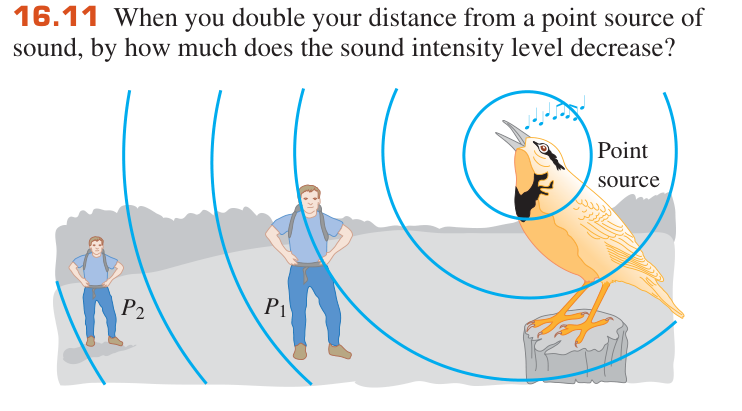

## Solution

### Identify and Set Up

The decibel scale is logarithmic, so the difference between two sound intensity levels (the target variable) corresponds to the ratio of the corresponding intensities, which is determined by the inverse-square law. We label the two points $P_1$ and $P_2$ (Fig. 16.11). We use Eq. (16.15), the definition of sound intensity level, at each point. We use Eq. (15.26), the inverse-square law, to relate the intensities at the two points.

### Execute

The difference $\beta_2-\beta_1$ between any two sound intensity levels is related to the corresponding intensities by

$$
\begin{aligned}
\beta_2-\beta_1
&=(10\ \mathrm{dB})\left(\log\frac{I_2}{I_0}-\log\frac{I_1}{I_0}\right)\\
&=(10\ \mathrm{dB})\bigl[(\log I_2-\log I_0)-(\log I_1-\log I_0)\bigr]\\
&=(10\ \mathrm{dB})\log\frac{I_2}{I_1}
\end{aligned}
$$

For this inverse-square-law source, Eq. (15.26) yields $I_2/I_1=r_1^2/r_2^2=1/4$, so

$$
\beta_2-\beta_1=(10\ \mathrm{dB})\log\frac{I_2}{I_1}
=(10\ \mathrm{dB})\log\frac14=-6.0\ \mathrm{dB}
$$

> [!note] Correction to the printed equation
> The book's last substitution line prints $I_1/I_2$. It should be $I_2/I_1$, consistent with the preceding derivation, the substitution $1/4$, and the result $-6.0\ \mathrm{dB}$.

### Evaluate

Our result is negative, which tells us (correctly) that the sound intensity level is less at $P_2$ than at $P_1$. The $6$-dB difference doesn't depend on the sound intensity level at $P_1$; any doubling of the distance from an inverse-square-law source reduces the sound intensity level by $6\ \mathrm{dB}$.

Note that the perceived loudness of a sound is not directly proportional to its intensity. For example, most people interpret an increase of $8\ \mathrm{dB}$ to $10\ \mathrm{dB}$ in sound intensity level (corresponding to increasing intensity by a factor of $6$ to $10$) as a doubling of loudness.

# Conceptual Example 16.10 — The sound of silence

A directional loudspeaker directs a sound wave of wavelength $\lambda$ at a wall (Fig. 16.14). At what distances from the wall could you stand and hear no sound at all?

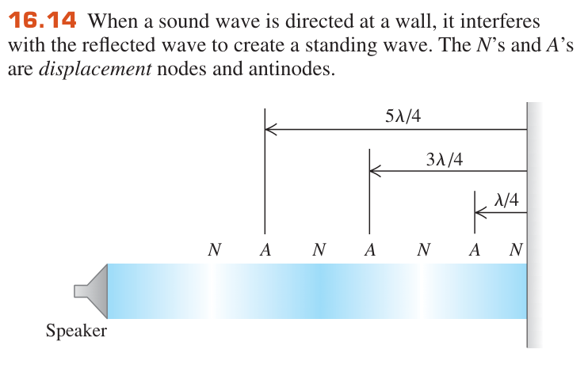

## Solution

Your ear detects pressure variations in the air; you will therefore hear no sound if your ear is at a pressure node, which is a displacement antinode. The wall is at a displacement node; the distance from any node to an adjacent antinode is $\lambda/4$, and the distance from one antinode to the next is $\lambda/2$ (Fig. 16.14). Hence the displacement antinodes (pressure nodes), at which no sound will be heard, are at distances $d=\lambda/4$, $d=\lambda/4+\lambda/2=3\lambda/4$, $d=3\lambda/4+\lambda/2=5\lambda/4$, $\ldots$ from the wall. If the loudspeaker is not highly directional, this effect is hard to notice because of reflections of sound waves from the floor, ceiling, and other walls.

# Example 16.11 — A tale of two pipes

On a day when the speed of sound is $345\ \mathrm{m/s}$, the fundamental frequency of a particular stopped organ pipe is $220\ \mathrm{Hz}$. (a) How long is this pipe? (b) The second overtone of this pipe has the same wavelength as the third harmonic of an open pipe. How long is the open pipe?

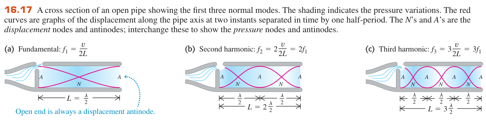

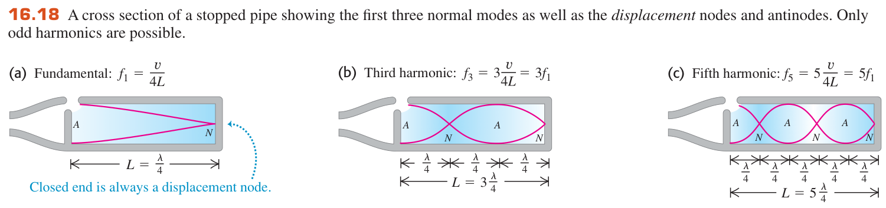

## Solution

### Identify and Set Up

This problem uses the relationship between the length and normal-mode frequencies of open pipes (Fig. 16.17) and stopped pipes (Fig. 16.18). In part (a), we determine the length of the stopped pipe from Eq. (16.22). In part (b), we must determine the length of an open pipe, for which Eq. (16.18) gives the frequencies.

### Execute

(a) For a stopped pipe $f_1=v/(4L)$, so

$$
L_{\mathrm{stopped}}=\frac{v}{4f_1}
=\frac{345\ \mathrm{m/s}}{4(220\ \mathrm{s^{-1}})}=0.392\ \mathrm{m}
$$

(b) The frequency of the second overtone of a stopped pipe (the third possible frequency) is $f_5=5f_1=5(220\ \mathrm{Hz})=1100\ \mathrm{Hz}$. If the wavelengths for the two pipes are the same, the frequencies are also the same. Hence the frequency of the third harmonic of the open pipe, which is at $3f_1=3(v/2L)$, equals $1100\ \mathrm{Hz}$. Then

$$
1100\ \mathrm{Hz}=3\left(\frac{345\ \mathrm{m/s}}{2L_{\mathrm{open}}}\right),
\qquad L_{\mathrm{open}}=0.470\ \mathrm{m}
$$

### Evaluate

The $0.392$-m stopped pipe has a fundamental frequency of $220\ \mathrm{Hz}$; the longer ($0.470$-m) open pipe has a higher fundamental frequency, $(1100\ \mathrm{Hz})/3=367\ \mathrm{Hz}$. This is not a contradiction, as you can see if you compare Figs. 16.17a and 16.18a.

# Example 16.12 — An organ–guitar duet

A stopped organ pipe is sounded near a guitar, causing one of the strings to vibrate with large amplitude. We vary the string tension until we find the maximum amplitude. The string is $80\%$ as long as the pipe. If both pipe and string vibrate at their fundamental frequency, calculate the ratio of the wave speed on the string to the speed of sound in air.

## Solution

### Identify and Set Up

The large response of the string is an example of resonance. It occurs because the organ pipe and the guitar string have the same fundamental frequency. Letting the subscripts $a$ and $s$ stand for the air in the pipe and the string, respectively, the condition for resonance is $f_{1a}=f_{1s}$. Equation (16.20) gives the fundamental frequency for a stopped pipe, and Eq. (15.32) gives the fundamental frequency for a guitar string held at both ends. These expressions involve the wave speed in air ($v_a$) and on the string ($v_s$) and the lengths of the pipe and string. We are given that $L_s=0.80L_a$; our target variable is the ratio $v_s/v_a$.

### Execute

From Eqs. (16.20) and (15.32), $f_{1a}=v_a/(4L_a)$ and $f_{1s}=v_s/(2L_s)$. These frequencies are equal, so

$$
\frac{v_a}{4L_a}=\frac{v_s}{2L_s}
$$

Substituting $L_s=0.80L_a$ and rearranging, we get $v_s/v_a=0.40$.

### Evaluate

As an example, if the speed of sound in air is $345\ \mathrm{m/s}$, the wave speed on the string is $(0.40)(345\ \mathrm{m/s})=138\ \mathrm{m/s}$. Note that while the standing waves in the pipe and on the string have the same frequency, they have different wavelengths $\lambda=v/f$ because the two media have different wave speeds $v$. Which standing wave has the greater wavelength?

# Example 16.13 — Loudspeaker interference

Two small loudspeakers, $A$ and $B$ (Fig. 16.23), are driven by the same amplifier and emit pure sinusoidal waves in phase. (a) For what frequencies does constructive interference occur at point $P$? (b) For what frequencies does destructive interference occur? The speed of sound is $350\ \mathrm{m/s}$.

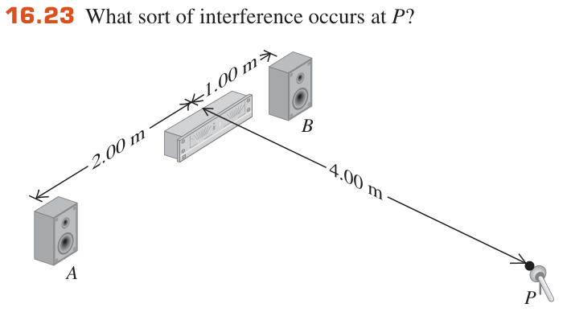

## Solution

### Identify and Set Up

The nature of the interference at $P$ depends on the difference $d$ in path lengths from point $A$ to $P$ and from point $B$ to $P$. We calculate the path lengths using the Pythagorean theorem. Constructive interference occurs when $d$ equals a whole number of wavelengths, while destructive interference occurs when $d$ is a half-integer number of wavelengths. To find the corresponding frequencies, we use $v=f\lambda$.

### Execute

The distance from $A$ to $P$ is $[(2.00\ \mathrm{m})^2+(4.00\ \mathrm{m})^2]^{1/2}=4.47\ \mathrm{m}$, and the distance from $B$ to $P$ is $[(1.00\ \mathrm{m})^2+(4.00\ \mathrm{m})^2]^{1/2}=4.12\ \mathrm{m}$. The path difference is $d=4.47\ \mathrm{m}-4.12\ \mathrm{m}=0.35\ \mathrm{m}$.

(a) Constructive interference occurs when $d=0$, $\lambda$, $2\lambda$, $\ldots$ or $d=0$, $v/f$, $2v/f$, $\ldots=nv/f$. So the possible frequencies are

$$
\begin{aligned}
f_n&=\frac{nv}{d}=n\frac{350\ \mathrm{m/s}}{0.35\ \mathrm{m}},\qquad n=1,2,3,\ldots\\
&=1000\ \mathrm{Hz},\ 2000\ \mathrm{Hz},\ 3000\ \mathrm{Hz},\ldots
\end{aligned}
$$

(b) Destructive interference occurs when $d=\lambda/2$, $3\lambda/2$, $5\lambda/2$, $\ldots$ or $d=v/(2f)$, $3v/(2f)$, $5v/(2f)$, $\ldots$. The possible frequencies are

$$
\begin{aligned}
f_n&=\frac{nv}{2d}=n\frac{350\ \mathrm{m/s}}{2(0.35\ \mathrm{m})},\qquad n=1,3,5,\ldots\\
&=500\ \mathrm{Hz},\ 1500\ \mathrm{Hz},\ 2500\ \mathrm{Hz},\ldots
\end{aligned}
$$

### Evaluate

As we increase the frequency, the sound at point $P$ alternates between large and small (near zero) amplitudes, with maxima and minima at the frequencies given above. This effect may not be strong in an ordinary room because of reflections from the walls, floor, and ceiling. It is stronger outdoors and best in an anechoic chamber, which has walls that absorb almost all sound and thereby eliminate reflections.

# Example 16.14 — Doppler effect I: Wavelengths

A police car's siren emits a sinusoidal wave with frequency $f_S=300\ \mathrm{Hz}$. The speed of sound is $340\ \mathrm{m/s}$ and the air is still. (a) Find the wavelength of the waves if the siren is at rest. (b) Find the wavelengths of the waves in front of and behind the siren if it is moving at $30\ \mathrm{m/s}$.

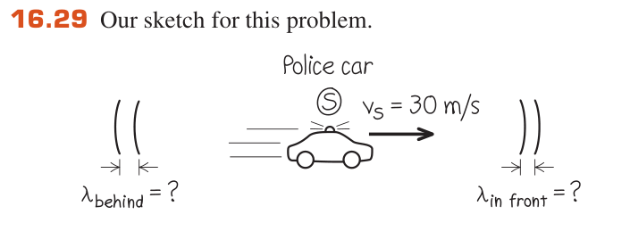

## Solution

### Identify and Set Up

In part (a) there is no Doppler effect because neither source nor listener is moving with respect to the air; $v=\lambda f$ gives the wavelength. Figure 16.29 shows the situation in part (b): The source is in motion, so we find the wavelengths using Eqs. (16.27) and (16.28) for the Doppler effect.

### Execute

(a) When the source is at rest,

$$
\lambda=\frac{v}{f_S}=\frac{340\ \mathrm{m/s}}{300\ \mathrm{Hz}}=1.13\ \mathrm{m}
$$

(b) From Eq. (16.27), in front of the siren

$$
\lambda_{\mathrm{in\ front}}=\frac{v-v_S}{f_S}
=\frac{340\ \mathrm{m/s}-30\ \mathrm{m/s}}{300\ \mathrm{Hz}}=1.03\ \mathrm{m}
$$

From Eq. (16.28), behind the siren

$$
\lambda_{\mathrm{behind}}=\frac{v+v_S}{f_S}
=\frac{340\ \mathrm{m/s}+30\ \mathrm{m/s}}{300\ \mathrm{Hz}}=1.23\ \mathrm{m}
$$

### Evaluate

The wavelength is shorter in front of the siren and longer behind it, as we expect.

# Example 16.15 — Doppler effect II: Frequencies

If a listener $L$ is at rest and the siren in Example 16.14 is moving away from $L$ at $30\ \mathrm{m/s}$, what frequency does the listener hear?

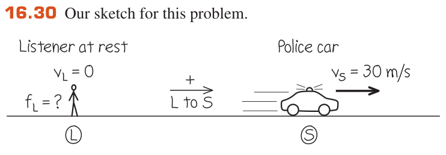

## Solution

### Identify and Set Up

Our target variable is the frequency $f_L$ heard by a listener behind the moving source. Figure 16.30 shows the situation. We have $v_L=0$ and $v_S=+30\ \mathrm{m/s}$ (positive, since the velocity of the source is in the direction from listener to source).

### Execute

From Eq. (16.29),

$$
f_L=\frac{v}{v+v_S}f_S
=\frac{340\ \mathrm{m/s}}{340\ \mathrm{m/s}+30\ \mathrm{m/s}}(300\ \mathrm{Hz})=276\ \mathrm{Hz}
$$

### Evaluate

The source and listener are moving apart, so $f_L<f_S$. Here's a check on our numerical result. From Example 16.14, the wavelength behind the source (where the listener in Fig. 16.30 is located) is $1.23\ \mathrm{m}$. The wave speed relative to the stationary listener is $v=340\ \mathrm{m/s}$ even though the source is moving, so

$$
f_L=\frac{v}{\lambda}=\frac{340\ \mathrm{m/s}}{1.23\ \mathrm{m}}=276\ \mathrm{Hz}
$$

# Example 16.16 — Doppler effect III: A moving listener

If the siren is at rest and the listener is moving away from it at $30\ \mathrm{m/s}$, what frequency does the listener hear?

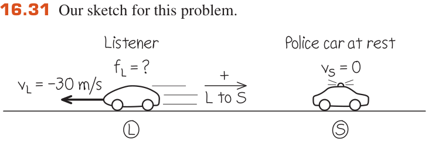

## Solution

### Identify and Set Up

Again our target variable is $f_L$, but now $L$ is in motion and $S$ is at rest. Figure 16.31 shows the situation. The velocity of the listener is $v_L=-30\ \mathrm{m/s}$ (negative, since the motion is in the direction from source to listener).

### Execute

From Eq. (16.29),

$$
f_L=\frac{v+v_L}{v}f_S
=\frac{340\ \mathrm{m/s}+(-30\ \mathrm{m/s})}{340\ \mathrm{m/s}}(300\ \mathrm{Hz})=274\ \mathrm{Hz}
$$

### Evaluate

Again the source and listener are moving apart, so $f_L<f_S$. Note that the relative velocity of source and listener is the same as in Example 16.15, but the Doppler shift is different because $v_S$ and $v_L$ are different.

# Example 16.17 — Doppler effect IV: Moving source, moving listener

The siren is moving away from the listener with a speed of $45\ \mathrm{m/s}$ relative to the air, and the listener is moving toward the siren with a speed of $15\ \mathrm{m/s}$ relative to the air. What frequency does the listener hear?

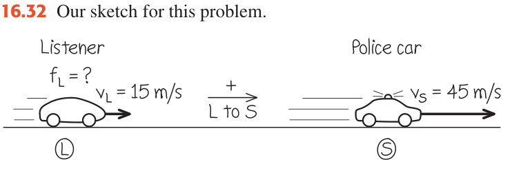

## Solution

### Identify and Set Up

Now both $L$ and $S$ are in motion. Again our target variable is $f_L$. Both the source velocity $v_S=+45\ \mathrm{m/s}$ and the listener's velocity $v_L=+15\ \mathrm{m/s}$ are positive because both velocities are in the direction from listener to source.

### Execute

From Eq. (16.29),

$$
f_L=\frac{v+v_L}{v+v_S}f_S
=\frac{340\ \mathrm{m/s}+15\ \mathrm{m/s}}{340\ \mathrm{m/s}+45\ \mathrm{m/s}}(300\ \mathrm{Hz})=277\ \mathrm{Hz}
$$

### Evaluate

As in Examples 16.15 and 16.16, the source and listener again move away from each other at $30\ \mathrm{m/s}$, so again $f_L<f_S$. But $f_L$ is different in all three cases because the Doppler effect for sound depends on how the source and listener are moving relative to the air, not simply on how they move relative to each other.

# Example 16.18 — Doppler effect V: A double Doppler shift

The police car is moving toward a warehouse at $30\ \mathrm{m/s}$. What frequency does the driver hear reflected from the warehouse?

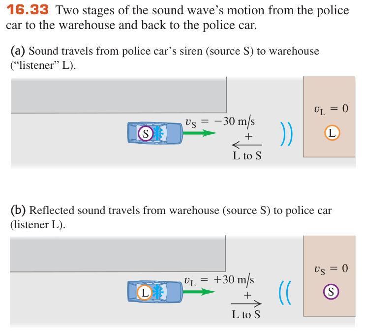

## Solution

### Identify

In this situation there are two Doppler shifts (Fig. 16.33). In the first shift, the warehouse is the stationary “listener.” The frequency of sound reaching the warehouse, which we call $f_W$, is greater than $300\ \mathrm{Hz}$ because the source is approaching. In the second shift, the warehouse acts as a source of sound with frequency $f_W$, and the listener is the driver of the police car; she hears a frequency greater than $f_W$ because she is approaching the source.

### Set Up

To determine $f_W$, we use Eq. (16.29) with $f_L$ replaced by $f_W$. For this part of the problem, $v_L=v_W=0$ (the warehouse is at rest) and $v_S=-30\ \mathrm{m/s}$ (the siren is moving in the negative direction from source to listener).

To determine the frequency heard by the driver (our target variable), we again use Eq. (16.29) but now with $f_S$ replaced by $f_W$. For this second part of the problem, $v_S=0$ because the stationary warehouse is the source and the velocity of the listener (the driver) is $v_L=+30\ \mathrm{m/s}$. (The listener's velocity is positive because it is in the direction from listener to source.)

### Execute

The frequency reaching the warehouse is

$$
f_W=\frac{v}{v+v_S}f_S
=\frac{340\ \mathrm{m/s}}{340\ \mathrm{m/s}+(-30\ \mathrm{m/s})}(300\ \mathrm{Hz})=329\ \mathrm{Hz}
$$

Then the frequency heard by the driver is

$$
f_L=\frac{v+v_L}{v}f_W
=\frac{340\ \mathrm{m/s}+30\ \mathrm{m/s}}{340\ \mathrm{m/s}}(329\ \mathrm{Hz})=358\ \mathrm{Hz}
$$

### Evaluate

Because there are two Doppler shifts, the reflected sound heard by the driver has an even higher frequency than the sound heard by a stationary listener in the warehouse.

# Example 16.19 — Sonic boom from a supersonic airplane

An airplane is flying at Mach $1.75$ at an altitude of $8000\ \mathrm{m}$, where the speed of sound is $320\ \mathrm{m/s}$. How long after the plane passes directly overhead will you hear the sonic boom?

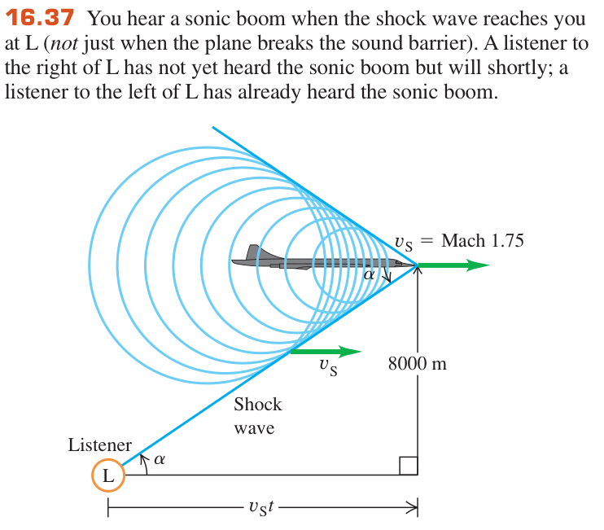

## Solution

### Identify and Set Up

The shock wave forms a cone trailing backward from the airplane, so the problem is really asking for how much time elapses from when the airplane flies overhead to when the shock wave reaches you at point $L$ (Fig. 16.37). During the time $t$ (our target variable) since the airplane traveling at speed $v_S$ passed overhead, it has traveled a distance $v_St$. Equation (16.31) gives the shock cone angle $\alpha$; we use trigonometry to solve for $t$.

### Execute

From Eq. (16.31) the angle $\alpha$ of the shock cone is

$$
\alpha=\arcsin\frac{1}{1.75}=34.8^\circ
$$

The speed of the plane is the speed of sound multiplied by the Mach number:

$$
v_S=(1.75)(320\ \mathrm{m/s})=560\ \mathrm{m/s}
$$

From Fig. 16.37 we have

$$
\tan\alpha=\frac{8000\ \mathrm{m}}{v_St}
$$

$$
t=\frac{8000\ \mathrm{m}}{(560\ \mathrm{m/s})(\tan34.8^\circ)}=20.5\ \mathrm{s}
$$

### Evaluate

You hear the boom $20.5\ \mathrm{s}$ after the airplane passes overhead, at which time it has traveled $(560\ \mathrm{m/s})(20.5\ \mathrm{s})=11.5\ \mathrm{km}$ since it passed overhead. We have assumed that the speed of sound is the same at all altitudes, so that $\alpha=\arcsin(v/v_S)$ is constant and the shock wave forms a perfect cone. In fact, the speed of sound decreases with increasing altitude. How would this affect the value of $t$?
