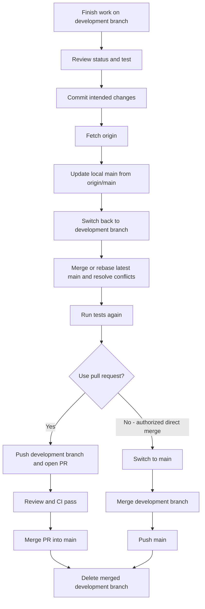

# Git Commands and Options

## Navigation

- [[#Everyday commands]]
- [[#Inspecting changes and history]]
- [[#Branches]]
- [[#Staging and commits]]
- [[#Remote repositories]]
- [[#Undoing safely]]
- [[#What to do in this situation]]
  - [[#Merge a development branch into production/main]]

## Everyday commands

| Command | Purpose |
|---|---|
| `git status` | Show the current branch plus changed, staged, and untracked files. Start here when unsure. |
| `git add <file>` | Stage one file for the next commit. |
| `git add .` | Stage all changes below the current directory. Review with `git status` before committing. |
| `git commit -m "message"` | Create a commit from staged changes. Use a short, imperative description. |
| `git log --oneline --decorate -n 10` | Show the most recent commits compactly, including branch names. |
| `git diff` | Show unstaged changes. |
| `git diff --staged` | Show what the next commit will contain. |

## Inspecting changes and history

| Command | Purpose |
|---|---|
| `git diff <branch>...HEAD` | Compare the current branch against its common ancestor with another branch. Useful before a pull request. |
| `git show <commit>` | Show one commit's message and patch. |
| `git blame <file>` | Show which commit last changed each line of a file. |
| `git log -- <file>` | Show only commits that affected a file. |
| `git reflog` | Show where `HEAD` and branches recently pointed; useful for recovering from mistakes. |
| `git ls-files` | List tracked files. |

## Branches

| Command | Purpose |
|---|---|
| `git branch` | List local branches. |
| `git branch -a` | List local and remote-tracking branches. |
| `git switch <branch>` | Change to an existing branch. |
| `git switch -c <branch>` | Create a branch and switch to it. |
| `git branch -d <branch>` | Delete a branch only after it has been merged. |
| `git branch -D <branch>` | Force-delete a branch. Use only when its commits are intentionally no longer needed. |
| `git merge <branch>` | Merge the named branch into the currently checked-out branch. |
| `git rebase <branch>` | Replay the current branch's commits on top of another branch. Avoid rebasing commits already shared with others. |

## Staging and commits

| Command | Purpose |
|---|---|
| `git add -p` | Stage selected hunks interactively. Great for separating unrelated changes. |
| `git restore --staged <file>` | Unstage a file without losing its edits. |
| `git commit --amend` | Replace the most recent commit with the current staged content and/or a new message. Do not amend a commit already shared unless the team agrees. |
| `git commit --no-verify` | Skip commit hooks. Use only when you understand why a hook must be bypassed. |
| `git commit -am "message"` | Stage and commit modifications to already tracked files; it does not include new untracked files. |

## Remote repositories

| Command | Purpose |
|---|---|
| `git remote -v` | Show configured remote names and URLs. |
| `git fetch origin` | Download remote branch information without changing local files. |
| `git pull --ff-only` | Fetch and update only if Git can fast-forward; avoids an unexpected merge commit. |
| `git push` | Publish the current branch to its configured upstream. |
| `git push -u origin <branch>` | Publish a new branch and set its upstream. |
| `git push origin <local>:<remote>` | Explicitly push a local branch to a named remote branch. Verify both names first. |

## Undoing safely

| Situation | Preferred command | Result |
|---|---|---|
| Discard unstaged edits to one file | `git restore <file>` | Restores the file to its last committed state. |
| Unstage a file | `git restore --staged <file>` | Keeps its edits, removes it from the next commit. |
| Undo a shared commit | `git revert <commit>` | Makes a new commit that reverses the old one; safest for published history. |
| Restore a lost branch/commit | `git reflog` then `git switch -c recovery <hash>` | Makes a new recovery branch at the earlier commit. |

> Be cautious with `git reset --hard`, `git clean -fd`, and force pushes. They can discard work or rewrite shared history.

## What to do in this situation

### Merge a development branch into production/main

Use a pull request when the repository has branch protection, review requirements, or CI. The local workflow below is appropriate only when you are authorized to merge directly into `main` (or `production`).



#### Recommended pull-request workflow

1. On the development branch, verify the exact work to be shared:

   ```bash
   git status
   git diff main...HEAD
   ```

2. Commit the intended changes, then update your view of the remote:

   ```bash
   git add <files>
   git commit -m "Describe the completed change"
   git fetch origin
   ```

3. Bring the development branch up to date with `main`. Choose the project convention: merge is safest for shared branches; rebase keeps a linear private branch history.

   ```bash
   git switch <development-branch>
   git merge origin/main
   # or, for an unshared branch:
   git rebase origin/main
   ```

4. Resolve any conflicts, run tests, then push the development branch:

   ```bash
   git add <resolved-files>
   git commit                 # only after a merge conflict
   git push -u origin <development-branch>
   ```

5. Open a pull request from `<development-branch>` into `main`. Merge only after required reviews and checks pass. Delete the remote branch after the merge if it is no longer needed.

#### Authorized direct-merge workflow

1. Start clean and update `main` without creating an accidental merge commit:

   ```bash
   git status
   git fetch origin
   git switch main
   git pull --ff-only origin main
   ```

2. Merge the development branch and resolve conflicts if necessary:

   ```bash
   git merge --no-ff <development-branch>
   ```

   `--no-ff` preserves a merge commit, making the feature branch visible in history. Omit it only if the project's history convention prefers fast-forward merges.

3. Test the merged result, then publish it:

   ```bash
   git push origin main
   ```

4. Confirm the production branch is correct before deleting the development branch:

   ```bash
   git log --oneline --decorate -n 10
   git branch -d <development-branch>
   git push origin --delete <development-branch>
   ```

#### If a merge conflict occurs

1. Run `git status` to see every conflicted file.
2. Edit each file between the conflict markers, keeping the intended combined content.
3. Stage each resolved file with `git add <file>`.
4. Complete the merge using `git commit` (or continue a rebase with `git rebase --continue`).
5. Run tests before pushing.

To abandon an in-progress merge before committing, use `git merge --abort`. To abandon an in-progress rebase, use `git rebase --abort`.
